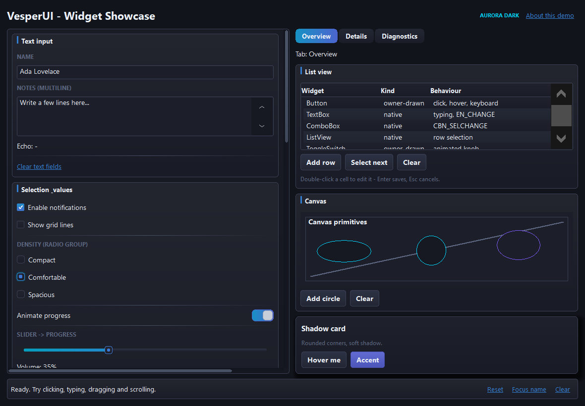
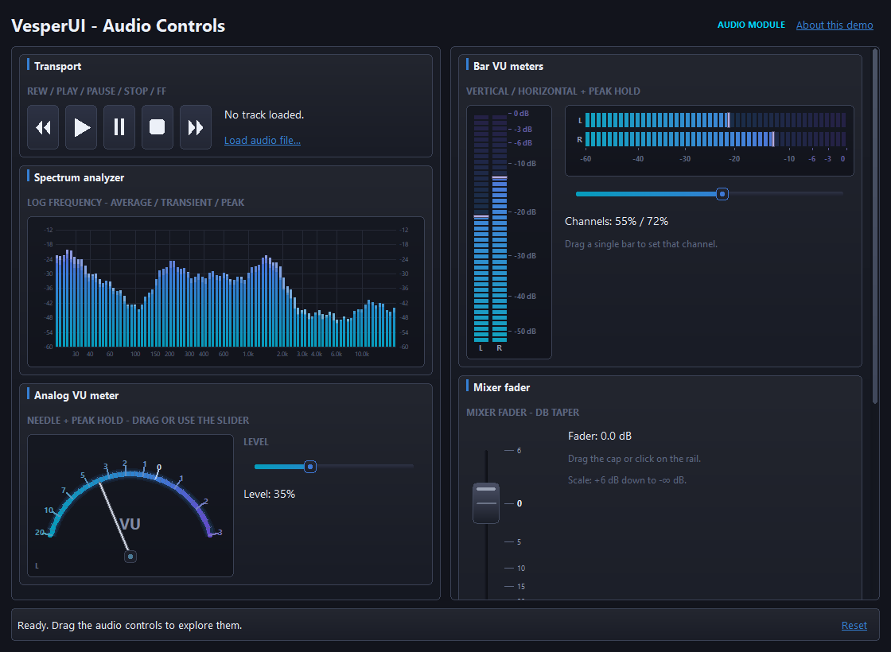

# VesperUI

[](https://github.com/GiuseppeCigala/vesperui/actions/workflows/tests.yml)
[](https://pypi.org/project/vesperui/)
[](https://pypi.org/project/vesperui/)
[](LICENSE)

**Native Windows widgets with an evening glow.**

VesperUI is a pure-Python Windows GUI toolkit built directly on the Win32 API
through `ctypes`. It combines native controls (`TextBox`, `ComboBox`,
`ListView`) with owner-drawn Aurora widgets (buttons, panels, tabs, toggles,
sliders, canvas, scroll views, meters and more) under one consistent dark
visual style. There are no third-party runtime dependencies.

## Highlights

- **Native where it matters.** Editable text, combo boxes and list views use
  the real Win32 controls, so IME, clipboard, accessibility and system themes
  keep working.
- **Owner-drawn where it shines.** Buttons, panels, sliders, meters, knobs and
  the rest are rendered with GDI+ style primitives for a coherent look.
- **Zero dependencies.** Only the Python standard library, `ctypes` and the
  Windows DLLs that ship with the operating system.
- **DPI aware.** Fonts, metrics and drawing scale with the monitor DPI.
- **Keyboard and mouse ready.** Tab focus, Enter/Space activation, arrow-key
  adjustment, mouse wheel scrolling and drag interactions are built in.
- **Testable off-screen.** Widgets can be painted into a memory DC, so layout
  and GDI bugs are caught by automated tests without showing a window.
- **Single file per widget.** The package is intentionally small and readable;
  every control lives in its own module.

## Requirements

- Windows 10 or Windows 11
- Python 3.8 or newer
- No runtime dependencies

VesperUI will raise a clear `ImportError` on non-Windows platforms.

## Installation

VesperUI is available on [PyPI](https://pypi.org/project/vesperui/):

```bash
python -m pip install vesperui
```

From a clone, including the development tools:

```bash
git clone https://github.com/GiuseppeCigala/vesperui.git
cd vesperui
python -m pip install -e ".[dev]"
```

## Screenshots

Classic controls, including native inputs, an editable list view and
owner-drawn widgets:



Audio controls: transport, spectrum analyzer, VU meters, mixer fader and knob:



Regenerate both images from the repository with:

```bash
python tools/capture_screenshots.py
```

Every widget class also has its own screenshot in the
[widget gallery](docs/gallery.md).

## Quick start

```python
import vesperui as ui

app = ui.App('Hello VesperUI', 640, 480)
app.root.layout = ui.VBoxLayout(padding=16, spacing=10)

app.root.add(ui.Label('Hello, world!', 20, True))
app.root.add(ui.Separator())
app.root.add(ui.Button(
    'Say hello',
    on_click=lambda: app.info('Hello from VesperUI!'),
))

app.run()
```

`App` creates the window, `app.root` is the main `Panel`, and `app.run()`
enters the Win32 message loop. Layout is applied automatically on creation,
resize and when native controls need to be realized.

A complete runnable version is in
[`examples/hello.py`](examples/hello.py):

```bash
python examples/hello.py
```

## Layout

Containers accept a layout object and a list of children:

```python
import vesperui as ui

app = ui.App('Layouts', 720, 420)
app.root.layout = ui.VBoxLayout(padding=14, spacing=10)

header = ui.Panel(layout=ui.HBoxLayout(padding=0, spacing=10))
header.add(ui.Label('Name', 14))
header.add(ui.TextBox('VesperUI'))

body = ui.Panel(layout=ui.HBoxLayout(padding=0, spacing=10))
body.add(ui.CheckBox('Enabled', checked=True))
body.add(ui.ToggleSwitch(checked=True))

app.root.add(header)
app.root.add(body)
app.run()
```

Available layouts are `VBoxLayout(padding=8, spacing=8)` and
`HBoxLayout(padding=8, spacing=8)`. A `ScrollView` also accepts children and
handles wheel scrolling internally.

## Widget reference

| Group | Widgets |
| --- | --- |
| Containers | `Panel`, `GroupBox`, `ScrollView`, `VBoxLayout`, `HBoxLayout` |
| Input | `TextBox`, `CheckBox`, `RadioButton`, `ComboBox`, `Stepper`, `ColorPicker` |
| Actions | `Button`, `Hyperlink`, `ToggleSwitch`, `MediaButton`, `TransportBar` |
| Selection | `Slider`, `MixerSlider`, `Knob`, `ProgressBar`, `TabBar` |
| Data | `ListView` (with in-place cell editing) |
| Audio | `VUMeter`, `LevelMeter` (`BarVUMeter` alias), `SpectrumAnalyzer` |
| Graphics | `Canvas` |
| Menus | `MenuBar`, `Menu` |
| Dialogs | `info`, `warning`, `error`, `question`, `ok_cancel`, `open_file`, `open_files`, `save_file`, `select_folder` |

`Slider` and `ProgressBar` support `orientation="h"` and `orientation="v"`.
`VUMeter` is an analog needle meter with drag and arrow-key adjustment plus
peak hold. `LevelMeter` draws one or two segmented bars with a dB scale.
`MixerSlider` is a mixer-style fader with a non-linear dB scale; `Knob` is a
rotary control with an accent ring and value plate. `SpectrumAnalyzer` renders
animated log-frequency bars with a dB grid, smoothed levels and peak caps.

See [docs/widgets.md](docs/widgets.md) for constructor signatures, methods and
interaction details.

## Styling

The default palette is `AURORA` (a dark, neon-accented theme). `FUSION` is
kept as a backwards-compatible alias. Build a custom palette with
`make_style`:

```python
import vesperui as ui

app = ui.App('Themed', 800, 600)
app.style = ui.make_style({
    'bg': (18, 20, 28),
    'fg': (236, 240, 248),
    'card': (28, 31, 42),
    'panel': (22, 25, 34),
    'accent': ((0, 214, 255), (124, 92, 255)),
})
app.bg = app.style['window']
app.theme_fg = app.style['windowText']
app.refresh_theme()
```

Every widget reads colors through `style_of(app)`, so a single `app.style`
assignment re-themes the whole interface. The palette keys are documented in
[docs/styling.md](docs/styling.md).

## Events and timers

Widgets expose plain Python callbacks:

```python
slider = ui.Slider(value=0.5, on_change=lambda value: print(value))
toggle = ui.ToggleSwitch(checked=True, on_change=lambda value: print(value))
button = ui.Button('Run', on_click=lambda: print('clicked'))

app.set_timer(1000, lambda: print('one second later'))
```

The `App` object also offers injection helpers (`click`, `move_mouse`,
`press_key`, `type_char`, `wheel`) so interaction can be driven from tests
without a physical mouse or keyboard.

## Showcase

Two interactive demos are included at the repository root:

```bash
python showcase_common.py       # classic controls
python showcase_audio.py        # audio controls
python showcase_common.py --check
python showcase_audio.py --check
```

`--check` builds and paints the whole interface into an off-screen bitmap and
exits, which is a fast smoke test for layout and GDI regressions.

## Documentation

- [Getting started](docs/getting-started.md)
- [Widget reference](docs/widgets.md)
- [Widget gallery](docs/gallery.md)
- [Styling and themes](docs/styling.md)
- [Architecture](docs/architecture.md)
- [Releasing](docs/releasing.md)
- [PyPI package](https://pypi.org/project/vesperui/)

## Testing

```bash
python run_tests.py
python run_tests.py -v
python run_tests.py test_dialogs
```

The suite uses `unittest`, runs on Windows and needs no extra packages.
Continuous integration runs it on Python 3.8 through 3.13 and also smoke-tests
both showcases.

## Project layout

```text
vesperui/            # the installable package, one module per widget
tests/               # unittest suite (headless and native-window tests)
examples/            # small runnable applications
docs/                # user and contributor documentation
docs/images/         # showcase screenshots used by the README
tools/               # development utilities (screenshot capture)
showcase_common.py   # classic controls demo
showcase_audio.py    # audio controls demo
run_tests.py         # test runner
```

## Contributing

Issues and pull requests are welcome. Please read
[CONTRIBUTING.md](CONTRIBUTING.md) and the
[Code of Conduct](CODE_OF_CONDUCT.md) before opening a pull request.

## License

VesperUI is released under the [MIT License](LICENSE).
