# Widget gallery

Individual screenshots of every VesperUI widget class, rendered off-screen at
96 DPI from the code in this repository. Native Win32 controls are composited
into the same image, so `TextBox`, `ComboBox` and `ListView` appear exactly as
the library draws them.

Regenerate the whole gallery with:

```bash
python tools/capture_widgets.py
```

See the [widget reference](widgets.md) for constructors and methods. The
[classic](images/showcase-common.png) and [audio](images/showcase-audio.png)
showcases show complete interfaces built from these widgets.

> Menus and dialogs are native Win32 objects rather than widgets, so they are
> not part of this gallery. See [Getting started](getting-started.md#menus).

## Containers

### Panel

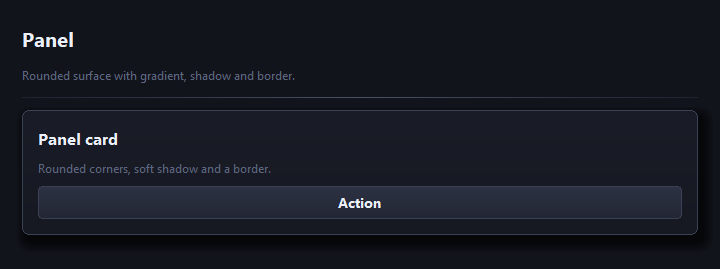

Rounded surface with a gradient, soft shadow and border.

### GroupBox

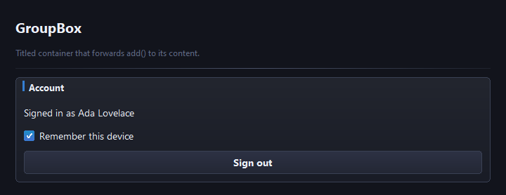

Titled frame that forwards `add()` to its content panel.

### ScrollView

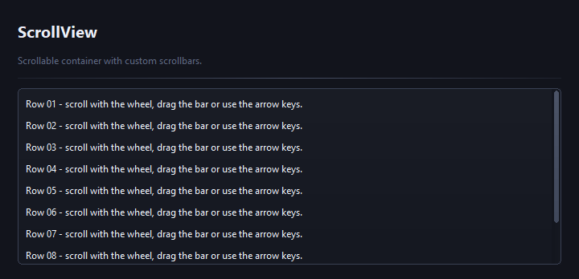

Scrollable container with custom scrollbars and native-control clipping.

## Text and labels

### Label

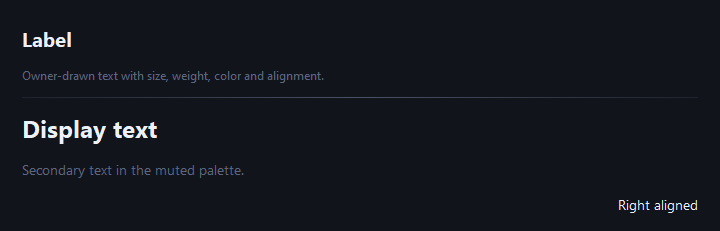

Owner-drawn text with size, weight, color and alignment.

### Hyperlink

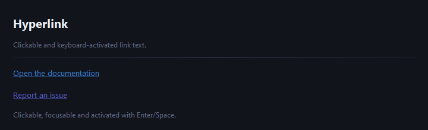

Clickable, focusable link text with hover feedback.

### Separator

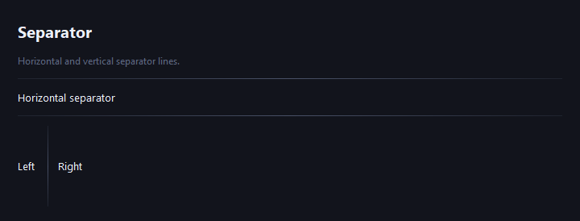

Horizontal and vertical one-pixel dividers.

## Input

### TextBox

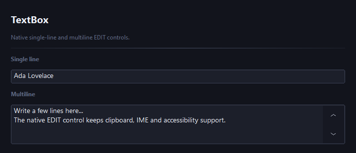

Native single-line and multiline `EDIT` controls.

### CheckBox

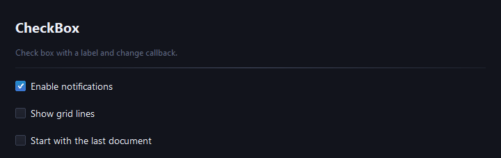

Check box with a label and change callback.

### RadioButton

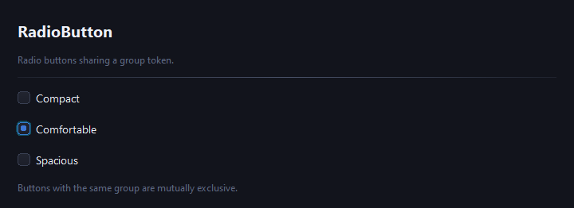

Radio buttons sharing a group token.

### ComboBox

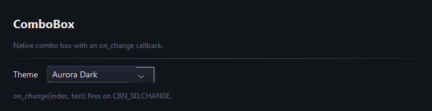

Native combo box with an `on_change(index, text)` callback.

### Stepper

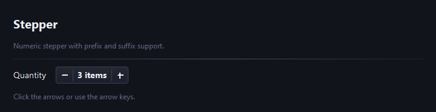

Numeric stepper with decrement/increment buttons and prefix/suffix support.

### ColorPicker

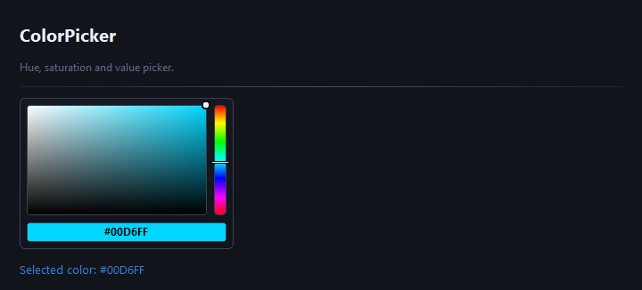

Hue, saturation and value picker with a color preview.

## Actions

### Button

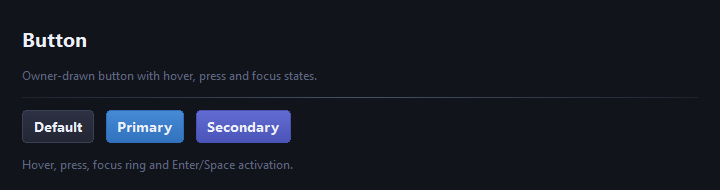

Owner-drawn button with hover, press, focus ring and keyboard activation.

### ToggleSwitch

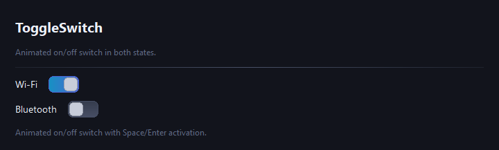

Animated on/off switch, shown in both states.

### MediaButton

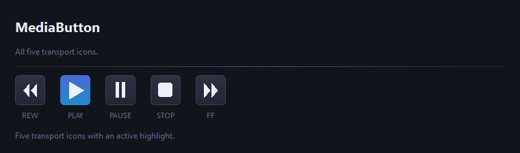

All five transport icons: rewind, play, pause, stop and fast-forward.

### TransportBar

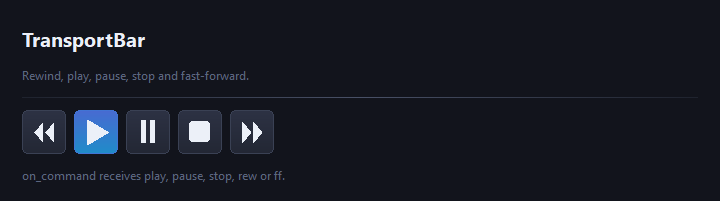

Rewind, play, pause, stop and fast-forward in one panel.

## Values

### Slider

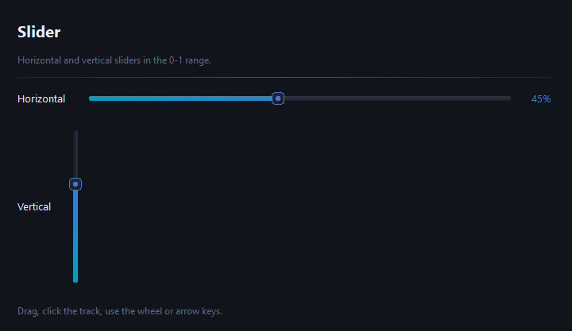

Horizontal and vertical sliders in the `0.0`–`1.0` range.

### ProgressBar

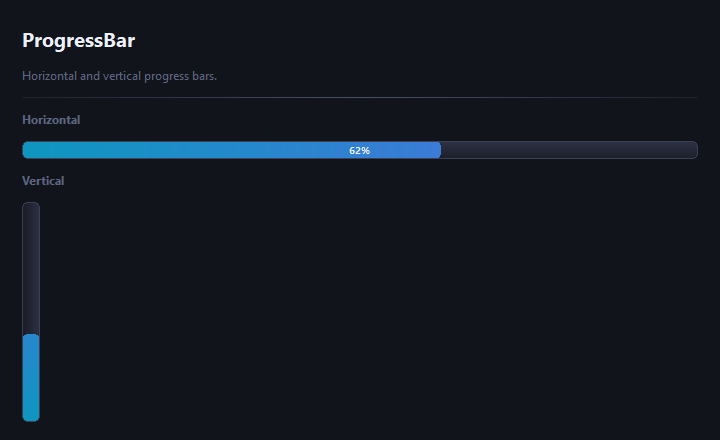

Horizontal and vertical progress bars, with optional text.

### Knob

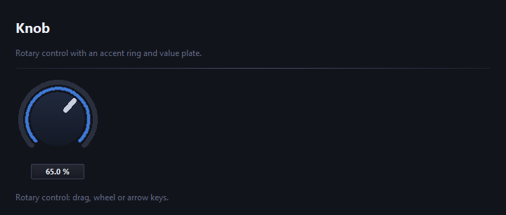

Rotary control with an accent ring, pointer and value plate.

### MixerSlider

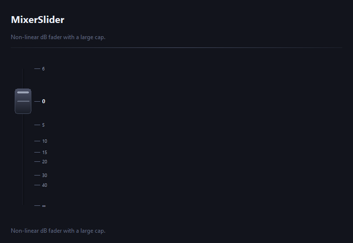

Non-linear dB fader with a large gray-gradient cap.

### TabBar

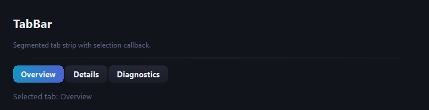

Segmented tab strip with a selection callback.

## Data

### ListView

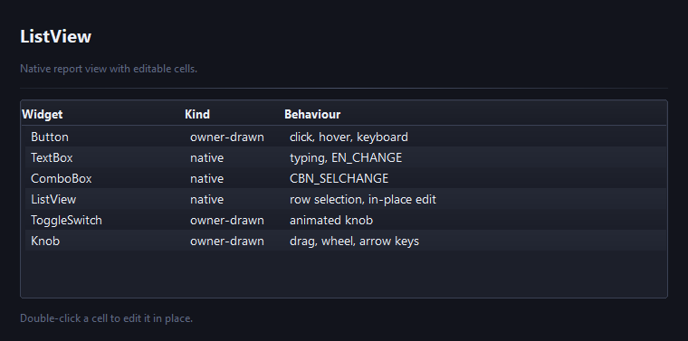

Native report view with row selection and in-place cell editing.

## Audio

### VUMeter

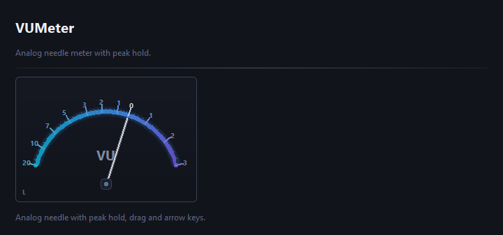

Analog needle meter with peak hold, drag and arrow-key adjustment.

### LevelMeter

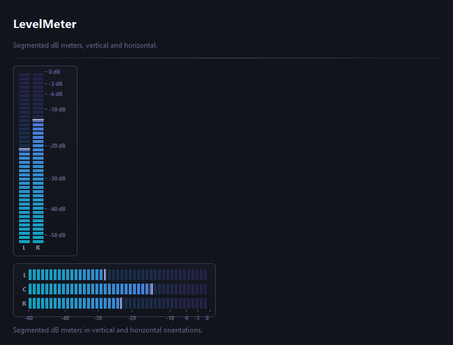

Segmented dB meters in vertical and horizontal orientations, using the soft
Aurora scale.

### SpectrumAnalyzer

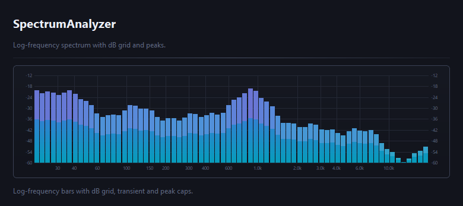

Log-frequency bars with a dB grid, transients and peak caps. The bars use the
same teal-to-violet gradient vertically, from low levels to high levels.

## Graphics

### Canvas

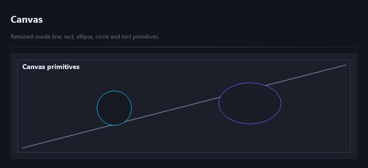

Retained-mode line, rectangle, ellipse, circle and text primitives.
